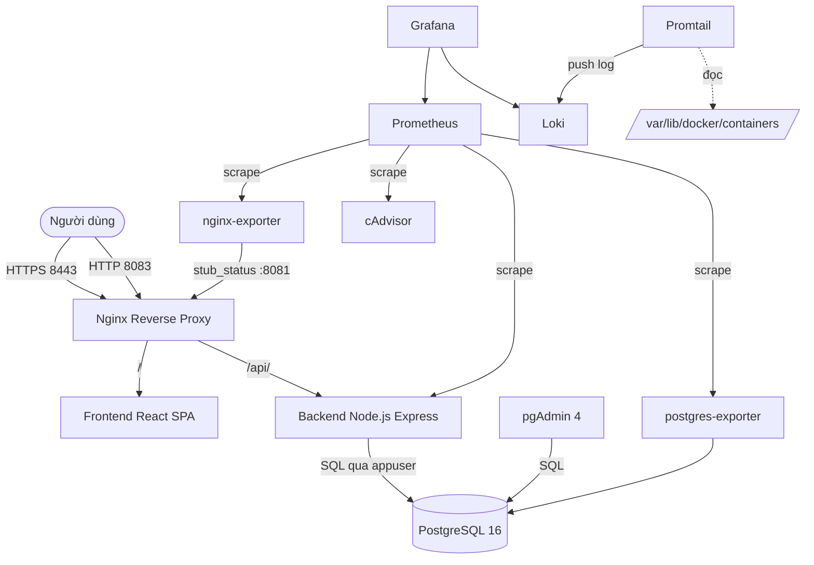

# BÁO CÁO ĐỒ ÁN

## ĐỀ TÀI 12: HỆ THỐNG QUẢN LÝ NHÀ HÀNG / ORDER

---

<!-- ============================================================================
     ⚠️ NGƯỜI DÙNG TỰ ĐIỀN THÔNG TIN BÊN DƯỚI
     Các giá trị trong <...> là placeholder do người soạn tài liệu để trống.
     KHÔNG có thông tin nào được suy đoán hay bịa đặt.
     ============================================================================ -->

| | |
|---|---|
| **Trường** | `<TRƯỜNG>` |
| **Khoa** | `<KHOA>` |
| **Môn học** | `<MÔN HỌC>` |
| **Đề tài** | Hệ thống quản lý nhà hàng / Order |
| **Sinh viên thực hiện** | `<HỌ TÊN>` |
| **Mã số sinh viên** | `<MSSV>` |
| **Lớp** | `<LỚP>` |
| **Giảng viên hướng dẫn** | `<GIẢNG VIÊN>` |
| **Địa điểm** | `<ĐỊA ĐIỂM>` |
| **Năm** | `<NĂM>` |

---

## MỤC LỤC

1. [Chương 1. Giới thiệu đề tài và mục tiêu](#chương-1-giới-thiệu-đề-tài-và-mục-tiêu)
2. [Chương 2. Phân tích yêu cầu và nghiệp vụ nhà hàng](#chương-2-phân-tích-yêu-cầu-và-nghiệp-vụ-nhà-hàng)
3. [Chương 3. Kiến trúc hệ thống và thiết kế cơ sở dữ liệu](#chương-3-kiến-trúc-hệ-thống-và-thiết-kế-cơ-sở-dữ-liệu)
4. [Chương 4. Triển khai ứng dụng, PostgreSQL và pgAdmin](#chương-4-triển-khai-ứng-dụng-postgresql-và-pgadmin)
5. [Chương 5. Nginx reverse proxy, HTTPS và security headers](#chương-5-nginx-reverse-proxy-https-và-security-headers)
6. [Chương 6. Prometheus, Grafana và giám sát](#chương-6-prometheus-grafana-và-giám-sát)
7. [Chương 7. Loki, Promtail và truy vấn LogQL](#chương-7-loki-promtail-và-truy-vấn-logql)
8. [Chương 8. Hardening bảo mật](#chương-8-hardening-bảo-mật)
9. [Chương 9. Kiểm thử, kết quả và minh chứng](#chương-9-kiểm-thử-kết-quả-và-minh-chứng)
10. [Chương 10. GitHub, Docker Compose và ba nhóm commit](#chương-10-github-docker-compose-và-ba-nhóm-commit)
11. [Kết luận, hạn chế và hướng phát triển](#kết-luận-hạn-chế-và-hướng-phát-triển)
12. [Tài liệu tham khảo](#tài-liệu-tham-khảo)
13. [Phụ lục](#phụ-lục)

---

## Chương 1. Giới thiệu đề tài và mục tiêu

### 1.1. Lý do chọn đề tài

Trong hoạt động của một nhà hàng quy mô vừa, việc ghi nhận và xử lý đơn hàng theo cách
thủ công (phiếu giấy, ghi nhớ bằng miệng) bộc lộ nhiều hạn chế:

- **Sai sót trong tính tiền.** Nhân viên phải tự nhân đơn giá với số lượng và cộng dồn,
  dễ nhầm khi đơn có nhiều món.
- **Không kiểm soát được tình trạng bàn.** Hai nhân viên có thể cùng mở đơn cho một bàn,
  gây thất lạc đơn hoặc tính tiền hai lần.
- **Không có số liệu tổng hợp.** Chủ nhà hàng không biết ngay hôm nay bán được bao nhiêu,
  món nào bán chạy.
- **Không truy vết được.** Khi có tranh chấp về hoá đơn, không có dữ liệu đối chiếu.

Một hệ thống quản lý tập trung giải quyết được cả bốn vấn đề trên, đồng thời tạo ra
dữ liệu phục vụ ra quyết định kinh doanh.

### 1.2. Mục tiêu của đề tài

**Mục tiêu nghiệp vụ:**

1. Số hoá quy trình từ lúc khách ngồi vào bàn đến lúc thanh toán và bàn được dọn.
2. Đảm bảo tính tiền luôn chính xác, do hệ thống tính chứ không do con người.
3. Ngăn chặn các sai sót nghiệp vụ: hai đơn trên một bàn, thanh toán hai lần,
   sửa đơn đã hoàn tất.

**Mục tiêu kỹ thuật:**

1. Triển khai toàn bộ hệ thống (ứng dụng, cơ sở dữ liệu, công cụ quản trị, reverse proxy)
   bằng **Docker Compose**, chạy được chỉ với một lệnh.
2. Xây dựng **hệ thống giám sát** để biết hệ thống có đang khoẻ mạnh và phục vụ bao nhiêu
   request, tốn bao nhiêu tài nguyên.
3. Xây dựng **hệ thống thu thập log tập trung** để tra cứu log của mọi dịch vụ tại một chỗ.
4. Áp dụng **các biện pháp hardening** để giảm thiểu bề mặt tấn công.

### 1.3. Phạm vi

**Trong phạm vi:**

- Quản lý thực đơn (danh mục, món ăn, giá, trạng thái còn/hết).
- Quản lý bàn ăn (trạng thái, chuyển bàn, gộp bàn).
- Quản lý đơn hàng (mở đơn, thêm/bớt món, trạng thái, màn hình bếp).
- Thanh toán và giải phóng bàn.
- Báo cáo doanh thu.

**Ngoài phạm vi:**

- Không tích hợp thiết bị phần cứng (máy in bếp, máy quẹt thẻ).
- Không tích hợp cổng thanh toán trực tuyến — thanh toán chỉ được ghi nhận, không xử lý giao dịch thật.
- Không có ứng dụng di động riêng; giao diện web tự co giãn cho màn hình nhỏ.
- Không có tính năng đặt bàn trực tuyến cho khách hàng.

### 1.4. Phương pháp thực hiện

| Bước | Nội dung |
|---|---|
| 1 | Khảo sát nghiệp vụ, xác định các thực thể và quy tắc |
| 2 | Thiết kế cơ sở dữ liệu quan hệ, đặt ràng buộc toàn vẹn |
| 3 | Xây dựng API backend, đặt các quy tắc nghiệp vụ **trong transaction** |
| 4 | Xây dựng giao diện người dùng |
| 5 | Đóng gói bằng Docker, dựng reverse proxy |
| 6 | Bổ sung giám sát và thu thập log |
| 7 | Áp dụng hardening |
| 8 | Kiểm thử và viết tài liệu |

---

## Chương 2. Phân tích yêu cầu và nghiệp vụ nhà hàng

### 2.1. Tác nhân và quyền hạn

Hệ thống có ba vai trò, được kiểm tra ở **tầng API** bằng middleware `authorize`,
không chỉ dựa vào việc ẩn nút trên giao diện:

| Vai trò | Quyền hạn |
|---|---|
| `admin` | Toàn quyền. Quản lý người dùng, xoá món/bàn/danh mục, xoá đơn |
| `staff` | Quản lý thực đơn (tạo/sửa/ẩn món), mở đơn, thêm món, chuyển trạng thái, thanh toán |
| `cashier` | Thanh toán, xem lịch sử thanh toán |

**Điểm quan trọng:** việc phân quyền chỉ ở giao diện là không đủ. Một người dùng
có thể gọi API trực tiếp bằng `curl`, bỏ qua hoàn toàn giao diện. Vì vậy mọi
endpoint đều có middleware `authenticate` và `authorize` kiểm tra ở server.

### 2.2. Quy tắc nghiệp vụ

| # | Quy tắc | Cách cưỡng chế |
|---|---|---|
| BR1 | Giá món ăn phải lấy từ cơ sở dữ liệu, không tin giá client gửi | Backend tra giá từ bảng `menu_items`, bỏ qua trường `unit_price` trong request |
| BR2 | Một bàn chỉ có tối đa một đơn đang hoạt động | `SELECT ... FOR UPDATE` trên hàng `dining_tables` trước khi tạo đơn |
| BR3 | Món đã ngừng bán không được thêm vào đơn mới | Kiểm tra `is_available` trong cả `create` và `addItems` |
| BR4 | Không thể bỏ món cuối cùng của đơn | Đếm số dòng còn lại; nếu ≤ 1 thì từ chối, yêu cầu huỷ đơn |
| BR5 | Không sửa đơn đã `completed` hoặc `cancelled` | Kiểm tra trạng thái trong `lockActiveOrder` |
| BR6 | Mỗi đơn chỉ thanh toán một lần | Khoá `orders` bằng `FOR UPDATE` + ràng buộc `UNIQUE` trên `payments.order_id` |
| BR7 | Bàn được giải phóng khi đơn hoàn tất hoặc bị huỷ | Cập nhật `dining_tables.status` trong cùng transaction |
| BR8 | Không đổi bàn về trống khi còn đơn hoạt động | Đếm đơn hoạt động trong transaction có `FOR UPDATE` |
| BR9 | Thành tiền từng dòng do cơ sở dữ liệu tính | Cột `subtotal` là `GENERATED ALWAYS AS (quantity * unit_price) STORED` |

### 2.3. Luồng nghiệp vụ chính

```
┌─────────────────────────────────────────────────────────────────────────┐
│                    LUỒNG PHỤC VỤ MỘT BÀN ĂN                             │
└─────────────────────────────────────────────────────────────────────────┘

  Khách vào bàn
        │
        ▼
  ┌───────────────┐   Bàn trống?     ┌──────────────────────┐
  │ Chọn bàn trống│──────Có─────────>│ Mở đơn (status=      │
  └───────────────┘                  │  pending)            │
        │                            │ Bàn → occupied       │
        │ Không (bàn có khách)       └──────────┬───────────┘
        ▼                                       │
  Thêm món vào đơn hiện tại                    ▼
        │                            ┌──────────────────────┐
        │                            │ Chọn món, số lượng   │
        │                            │ Hệ thống tính tổng   │
        │                            │ từ giá trong DB      │
        │                            └──────────┬───────────┘
        │                                       │
        │                                       ▼
        │                            ┌──────────────────────┐
        │                            │ Bếp nhận món         │
        │                            │ pending → preparing  │
        │                            │ → ready → served     │
        │                            └──────────┬───────────┘
        │                                       │
        │                                       ▼
        │                            ┌──────────────────────┐
        │                            │ Thanh toán           │
        │                            │ - Khoá đơn FOR UPDATE│
        │                            │ - Kiểm tra chưa trả  │
        │                            │ - Ghi payment        │
        │                            │ - Đơn → completed    │
        │                            │ - Bàn → available    │
        │                            └──────────────────────┘
```

### 2.4. Yêu cầu phi chức năng

| Loại | Yêu cầu | Cách đáp ứng |
|---|---|---|
| Toàn vẹn dữ liệu | Không được có đơn trỏ tới bàn không tồn tại | Khoá ngoại `orders.table_id → dining_tables(id)` |
| Toàn vẹn dữ liệu | Không được có số lượng ≤ 0 | `CHECK (quantity > 0)` |
| Tính đúng đắn | Tiền phải chính xác đến từng đồng | Kiểu `NUMERIC(12,2)`, tính trên số nguyên đơn vị nhỏ nhất |
| Bảo mật | Mật khẩu không lưu dạng thô | bcrypt cost 12 |
| Bảo mật | Không lộ secret ra Git | `.gitignore` chặn `.env`, `pgpass`, chứng chỉ, dump |
| Khả dụng | Hệ thống tự khởi động lại khi lỗi | `restart: unless-stopped` |
| Quan sát được | Biết hệ thống có đang chạy không | Healthcheck trên mọi container |
| Truy vết | Tra được log của mọi dịch vụ | Loki + Promtail |

---

## Chương 3. Kiến trúc hệ thống và thiết kế cơ sở dữ liệu

### 3.1. Kiến trúc tổng thể

Hệ thống gồm **12 container** chia thành ba mặt phẳng:

```
┌───────────────────────── MẶT PHẲNG ỨNG DỤNG ─────────────────────────┐
│                                                                      │
│   Người dùng ──HTTPS:8443──> ┌──────────┐                            │
│                ──HTTP:8083──>│  nginx   │  (chuyển hướng 301)        │
│                              │ reverse  │                            │
│                              │  proxy   │                            │
│                              └────┬─────┘                            │
│                        /          │          /api/                   │
│                        ▼          │          ▼                       │
│                 ┌───────────┐     │   ┌────────────┐                 │
│                 │ frontend  │     │   │  backend   │                 │
│                 │ React SPA │     │   │ Node.js    │                 │
│                 │  :8080    │     │   │  :3001     │                 │
│                 └───────────┘     │   └──────┬─────┘                 │
│                                   │          │ SQL                   │
│                                   │          ▼                       │
│                                   │   ┌────────────┐                 │
│                                   │   │ postgres:16│                 │
│                                   │   │   :5432    │                 │
│                                   │   └──────┬─────┘                 │
│                                   │          ▲                       │
│                                   │   ┌──────┴─────┐                 │
│                                   │   │  pgAdmin 4 │  loopback:5051  │
│                                   │   └────────────┘                 │
└───────────────────────────────────┼──────────────────────────────────┘
                                    │
┌───────────────────────────────────┼──────────────────────────────────┐
│                     MẶT PHẲNG GIÁM SÁT                               │
│                                   │                                  │
│   ┌────────────┐   scrape         │                                  │
│   │ Prometheus │◄─────────────────┴── backend:3001/metrics           │
│   │  :9090     │◄── postgres-exporter:9187                            │
│   │loopback:9091│◄── nginx-exporter:9113 ◄── nginx:8081/stub_status   │
│   └─────┬──────┘◄── cadvisor:8080                                     │
│         │                                                            │
│         ▼                                                            │
│   ┌────────────┐                                                     │
│   │  Grafana   │  loopback:3002                                      │
│   │   :3000    │                                                     │
│   └─────┬──────┘                                                     │
│         │ LogQL                                                      │
│         ▼                                                            │
│   ┌────────────┐   push    ┌────────────┐  đọc /var/lib/docker       │
│   │    Loki    │◄──────────│  Promtail  │◄── /containers/*/*.log     │
│   │   :3100    │           │   :9080    │                            │
│   └────────────┘           └────────────┘                            │
└──────────────────────────────────────────────────────────────────────┘
```

**Sơ đồ Mermaid** (nếu công cụ hỗ trợ hiển thị):



### 3.2. Vì sao chọn kiến trúc này

| Quyết định | Lý do | Đánh đổi |
|---|---|---|
| Nginx làm reverse proxy duy nhất | Tập trung TLS, security headers, giới hạn kích thước request tại một chỗ | Thêm một điểm có thể hỏng |
| Frontend build thành file tĩnh, phục vụ bằng nginx riêng | Không cần Node.js chạy ở frontend, nhẹ và nhanh | Phải build lại khi sửa giao diện |
| Tách hai mạng `app-net` và `mon-net` | Database không nằm chung mạng với Prometheus/Grafana, giảm bề mặt tấn công | Cấu hình phức tạp hơn |
| Exporter riêng cho PostgreSQL thay vì cho Prometheus truy vấn trực tiếp | Prometheus không hỗ trợ giao thức PostgreSQL; exporter chạy truy vấn chỉ-đọc | Thêm một container |
| Loki thay vì Elasticsearch | Loki chỉ đánh chỉ mục theo nhãn, không đánh chỉ mục toàn văn → nhẹ hơn nhiều | Truy vấn toàn văn chậm hơn |
| Promtail đọc log qua Docker socket | Tự động phát hiện container mới, không cần khai báo từng đường dẫn | Phải mount Docker socket |

### 3.3. Thiết kế cơ sở dữ liệu

#### 3.3.1. Sơ đồ quan hệ

```
┌──────────────┐         ┌────────────────┐         ┌──────────────┐
│  categories  │         │   menu_items   │         │ order_items  │
├──────────────┤         ├────────────────┤         ├──────────────┤
│ id       PK  │────1:N─>│ id         PK  │<───N:1──│ id        PK │
│ name  UNIQUE │         │ category_id FK │         │ order_id  FK │
│ description  │         │ name           │         │ menu_item_id │
│ sort_order   │         │ price  NUMERIC │         │ quantity     │
│ is_active    │         │ is_available   │         │ unit_price   │
└──────────────┘         └────────────────┘         │ subtotal GEN │
                                                    │ status       │
┌──────────────────┐     ┌────────────────┐         └──────┬───────┘
│  dining_tables   │     │     orders     │                │
├──────────────────┤     ├────────────────┤                │
│ id           PK  │─1:N>│ id         PK  │<───────────────┘
│ table_number UNIQ│     │ order_code UNIQ│
│ area             │     │ table_id   FK  │
│ capacity         │     │ user_id    FK  │
│ status           │     │ status         │
└──────────────────┘     │ subtotal       │
                         │ discount       │         ┌──────────────┐
┌──────────────┐         │ total_amount   │         │   payments   │
│    users     │         └───────┬────────┘         ├──────────────┤
├──────────────┤                 │                  │ id        PK │
│ id       PK  │────1:N──────────┘                  │ order_id  FK │
│ username UNIQ│                                    │      UNIQUE  │
│ password     │                                    │ amount       │
│ role  CHECK  │                                    │ method CHECK │
│ email        │                                    │ status CHECK │
│ is_active    │                                    │ paid_at      │
└──────────────┘                                    └──────────────┘
```

#### 3.3.2. Mô tả các bảng

**Bảng `users` — Tài khoản người dùng**

| Cột | Kiểu | Ràng buộc | Ghi chú |
|---|---|---|---|
| `id` | SERIAL | PK | |
| `username` | VARCHAR(50) | NOT NULL, UNIQUE | Lưu chữ thường |
| `password` | VARCHAR(255) | NOT NULL | Hash bcrypt, 60 ký tự |
| `full_name` | VARCHAR(100) | NOT NULL | |
| `role` | VARCHAR(20) | NOT NULL, CHECK IN ('admin','staff','cashier') | |
| `email` | VARCHAR(100) | UNIQUE (khi khác NULL) | Chỉ mục bộ phận |
| `is_active` | BOOLEAN | NOT NULL, DEFAULT TRUE | Vô hiệu hoá thay vì xoá |
| `created_at`, `updated_at` | TIMESTAMPTZ | NOT NULL | Trigger tự cập nhật |

**Bảng `menu_items` — Món ăn**

| Cột | Kiểu | Ràng buộc | Ghi chú |
|---|---|---|---|
| `id` | SERIAL | PK | |
| `category_id` | INT | NOT NULL, FK → `categories(id)` **ON DELETE RESTRICT** | Không xoá được danh mục còn món |
| `name` | VARCHAR(150) | NOT NULL | |
| `price` | **NUMERIC(12,2)** | NOT NULL, CHECK ≥ 0 | Kiểu số chính xác, không dùng FLOAT |
| `is_available` | BOOLEAN | NOT NULL, DEFAULT TRUE | Món ngừng bán |

**Bảng `dining_tables` — Bàn ăn**

| Cột | Kiểu | Ràng buộc |
|---|---|---|
| `table_number` | VARCHAR(10) | NOT NULL, UNIQUE |
| `capacity` | INT | NOT NULL, CHECK > 0 |
| `status` | VARCHAR(20) | NOT NULL, CHECK IN ('available','occupied','reserved','maintenance') |

**Bảng `orders` — Đơn hàng**

| Cột | Kiểu | Ràng buộc | Ghi chú |
|---|---|---|---|
| `order_code` | VARCHAR(20) | NOT NULL, UNIQUE | Sinh bởi hàm `generate_order_code()` |
| `table_id` | INT | NOT NULL, FK → `dining_tables(id)` ON DELETE RESTRICT | |
| `user_id` | INT | FK → `users(id)` **ON DELETE SET NULL** | Xoá nhân viên không mất đơn |
| `status` | VARCHAR(20) | CHECK IN ('pending','confirmed','preparing','ready','served','completed','cancelled') | |
| `subtotal`, `discount`, `total_amount` | NUMERIC(12,2) | NOT NULL, CHECK ≥ 0 | |

**Bảng `order_items` — Chi tiết đơn hàng** (bảng quan trọng nhất)

| Cột | Kiểu | Ràng buộc | Ghi chú |
|---|---|---|---|
| `order_id` | INT | NOT NULL, FK → `orders(id)` **ON DELETE CASCADE** | Xoá đơn thì xoá chi tiết |
| `menu_item_id` | INT | NOT NULL, FK → `menu_items(id)` ON DELETE RESTRICT | Không xoá món đã có trong đơn |
| `quantity` | INT | NOT NULL, **CHECK > 0** | |
| `unit_price` | NUMERIC(12,2) | NOT NULL, CHECK ≥ 0 | **Giá đã chốt tại thời điểm đặt** |
| `subtotal` | NUMERIC(12,2) | **GENERATED ALWAYS AS (quantity * unit_price) STORED** | CSDL tự tính |

**Vì sao `unit_price` nằm trong `order_items` chứ không chỉ đọc từ `menu_items`:**
giá món ăn có thể thay đổi theo thời gian. Đơn hàng là **chứng từ tài chính** —
khi chủ nhà hàng tăng giá Phở bò từ 70.000 lên 80.000, các đơn đã tạo hôm qua
phải giữ nguyên giá 70.000. Lưu `unit_price` tại thời điểm đặt là cách duy nhất
đảm bảo điều này.

**Bảng `payments` — Thanh toán**

| Cột | Kiểu | Ràng buộc | Ghi chú |
|---|---|---|---|
| `order_id` | INT | NOT NULL, FK → `orders(id)`, **UNIQUE** | **Ràng buộc chặn thanh toán 2 lần ở tầng dữ liệu** |
| `amount` | NUMERIC(12,2) | NOT NULL, CHECK ≥ 0 | |
| `method` | VARCHAR(30) | CHECK IN ('cash','card','transfer','other') | |
| `status` | VARCHAR(20) | CHECK IN ('pending','completed','refunded','failed') | |
| `paid_at` | TIMESTAMPTZ | | |

### 3.4. Chỉ mục (index)

| Chỉ mục | Bảng | Cột | Phục vụ truy vấn |
|---|---|---|---|
| `idx_orders_table_id` | orders | `table_id` | Tìm đơn theo bàn |
| `idx_orders_status` | orders | `status` | Lọc đơn theo trạng thái |
| `idx_orders_created_at` | orders | `created_at` | Sắp xếp đơn mới nhất |
| `idx_order_items_order_id` | order_items | `order_id` | Lấy chi tiết đơn |
| `idx_menu_items_category_id` | menu_items | `category_id` | Lọc món theo danh mục |
| `idx_menu_items_name` | menu_items | `name` | Tìm kiếm theo tên |
| `idx_users_email_unique` | users | `email` WHERE NOT NULL | Chỉ mục bộ phận, cho phép nhiều NULL |

### 3.5. Trigger tự cập nhật `updated_at`

Một hàm `update_updated_at_column()` được gắn vào cả 7 bảng. Nhờ vậy mọi thao tác
`UPDATE` tự động đặt `updated_at = NOW()` mà không phụ thuộc vào việc lập trình viên
có nhớ cập nhật cột đó trong câu lệnh hay không.

---

## Chương 4. Triển khai ứng dụng, PostgreSQL và pgAdmin

### 4.1. Backend

**Công nghệ:** Node.js 20, Express 4.19, thư viện `pg` 8.12.

**Cấu trúc:**

```
backend/src/
├── app.js                    # Cấu hình Express: helmet, cors, rate limit, routes
├── server.js                 # Khởi động, kiểm tra DB, tắt êm khi nhận SIGTERM
├── config/database.js        # Pool kết nối PostgreSQL
├── controllers/              # 8 controller nghiệp vụ
├── middlewares/              # Xác thực JWT + phân quyền theo vai trò
├── routes/                   # Khai báo endpoint
└── utils/                    # logger, metrics, query, money, validation
```

**Cấu hình pool kết nối:**

```js
const pool = new Pool({
  host: process.env.DB_HOST || 'postgres',   // tên service Docker, KHÔNG phải localhost
  port: 5432,
  max: 20,                                    // tối đa 20 kết nối đồng thời
  idleTimeoutMillis: 30000,
  connectionTimeoutMillis: 5000,              // thất bại sau 5s thay vì treo vô hạn
});
```

**Điểm quan trọng — `DB_HOST`:** bên trong container, `localhost` trỏ về chính container
đó, **không phải** máy host hay container database. Phải dùng tên service Docker
(`postgres`), Docker sẽ phân giải qua DNS nội bộ.

**Kiểm tra kết nối khi khởi động:** `server.js` chạy `SELECT 1` trước khi mở cổng.
Nếu thất bại, tiến trình **thoát** thay vì chạy ở trạng thái hỏng. Docker sẽ khởi động lại
(`restart: unless-stopped`) và sau vài lần thử, database đã sẵn sàng.

### 4.2. Dockerfile backend — build nhiều tầng

```dockerfile
FROM node:20-alpine AS base
FROM base AS deps
COPY package.json package-lock.json ./
RUN npm ci --omit=dev && npm cache clean --force

FROM base AS production
RUN addgroup -g 1001 -S nodejs && adduser -S nodeuser -u 1001 -G nodejs
COPY --from=deps --chown=nodeuser:nodejs /app/node_modules ./node_modules
COPY --chown=nodeuser:nodejs src/ ./src/
USER nodeuser
HEALTHCHECK --interval=30s --timeout=10s --start-period=40s --retries=3 \
  CMD wget -qO- http://127.0.0.1:3001/health || exit 1
CMD ["node", "src/server.js"]
```

Ba điểm đáng chú ý:

1. **Build nhiều tầng** — tầng `deps` chỉ cài thư viện production (`--omit=dev`),
   tầng `production` chỉ copy `node_modules` và `src`. Không mang theo
   `devDependencies`, mã nguồn test hay cache npm vào image cuối.
2. **Chạy non-root** — `USER nodeuser` (uid 1001) trước khi chạy ứng dụng.
3. **HEALTHCHECK** — Docker tự kiểm tra ứng dụng còn phản hồi không, dùng endpoint
   `/health` (endpoint này thực hiện `SELECT 1` để kiểm tra cả database).

### 4.3. Cơ sở dữ liệu — khởi tạo tự động

PostgreSQL chạy `database/init.sh` **một lần duy nhất**, khi thư mục dữ liệu còn trống:

```bash
1. Tạo role appuser (nếu chưa tồn tại), KHÔNG cấp SUPERUSER
2. Cấp quyền tối thiểu: CONNECT, USAGE, SELECT/INSERT/UPDATE/DELETE
3. Chạy migration: migrations/001_init_schema.sql
4. Cấp quyền trên các bảng vừa tạo
5. Chạy seed: seeds/001_seed_data.sql
```

> ⚠️ **Điểm cần hiểu rõ:** script này chỉ chạy khi thư mục dữ liệu **trống**.
> Nếu volume `restaurant-postgres-data` đã có dữ liệu, sửa `init.sh` hay file SQL
> **không có tác dụng** — phải xoá volume (mất dữ liệu) hoặc chạy migration thủ công.
> Đây là hành vi của image PostgreSQL chính thức, không phải lỗi thiết kế.

### 4.4. Tài khoản ứng dụng quyền tối thiểu

Ứng dụng kết nối bằng `appuser`, **không** dùng `postgres` (superuser):

```sql
CREATE ROLE appuser WITH LOGIN PASSWORD '...';
GRANT CONNECT ON DATABASE restaurant_db TO appuser;
GRANT USAGE ON SCHEMA public TO appuser;
ALTER DEFAULT PRIVILEGES IN SCHEMA public
  GRANT SELECT, INSERT, UPDATE, DELETE ON TABLES TO appuser;
ALTER DEFAULT PRIVILEGES IN SCHEMA public
  GRANT USAGE, SELECT ON SEQUENCES TO appuser;
```

Sau khi migration tạo bảng (do `postgres` thực hiện), cần cấp quyền **lần hai**
trên các bảng đã tồn tại:

```sql
GRANT SELECT, INSERT, UPDATE, DELETE ON ALL TABLES IN SCHEMA public TO appuser;
GRANT USAGE, SELECT ON ALL SEQUENCES IN SCHEMA public TO appuser;
```

**Vì sao cần cả hai bước:** `ALTER DEFAULT PRIVILEGES` chỉ áp dụng cho các object
được tạo **sau** lệnh đó, **bởi chính role đã chạy lệnh**. Vì migration chạy bằng
`postgres`, các bảng không tự động thuộc quyền `appuser` — phải `GRANT ... ON ALL TABLES`
một cách tường minh.

### 4.5. pgAdmin

pgAdmin được cấu hình sẵn để kết nối database mà người dùng không phải nhập tay:

- `docker/pgadmin/servers.json` — khai báo server `RestaurantDB` với
  `Host: postgres` (tên service Docker), `Port: 5432`, `Username: appuser`.
- `docker/pgadmin/pgpass` — file mật khẩu, để pgAdmin kết nối không cần hỏi mật khẩu.

Hai file này chứa thông tin nhạy cảm nên **đã được `.gitignore` chặn**. Repo chỉ chứa
file mẫu `servers.json.example` và `pgpass.example`.

**Truy cập:** http://127.0.0.1:5051 — chỉ bind loopback, không lộ ra mạng ngoài.

---

## Chương 5. Nginx reverse proxy, HTTPS và security headers

### 5.1. Vai trò của reverse proxy

Nginx là **điểm vào duy nhất** của hệ thống. Điều này cho phép:

- Tập trung cấu hình TLS ở một chỗ.
- Áp security headers cho **mọi** response mà không phải sửa từng ứng dụng.
- Giới hạn kích thước request body, thời gian chờ.
- Backend và frontend **không cần publish cổng ra host** — chỉ Nginx publish.

### 5.2. Định tuyến

```nginx
location / {
    proxy_pass http://frontend:8080;   # SPA tĩnh
}

location /api/ {
    proxy_pass http://backend:3001;    # API JSON
}

location = /health {
    proxy_pass http://backend:3001;    # kiểm tra sức khoẻ
}
```

### 5.3. Chuyển tiếp header

```nginx
proxy_set_header Host              $host;
proxy_set_header X-Real-IP         $remote_addr;
proxy_set_header X-Forwarded-For   $proxy_add_x_forwarded_for;
proxy_set_header X-Forwarded-Proto $scheme;
```

**Vì sao bốn header này quan trọng:**

| Header | Nếu thiếu thì sao |
|---|---|
| `Host` | Backend không biết domain gốc, sinh URL sai trong redirect |
| `X-Real-IP` | Backend chỉ thấy IP của Nginx, không biết IP người dùng |
| `X-Forwarded-For` | Log ghi sai IP, **rate limiting chặn nhầm toàn bộ người dùng** vì mọi request bị coi là cùng một IP |
| `X-Forwarded-Proto` | Backend sinh URL `http://` dù người dùng đang dùng `https://` |

Để Express đọc đúng các header này, backend phải khai báo `app.set('trust proxy', 1)`.
**Thiếu dòng này thì `req.ip` luôn trả về IP của Nginx** và cơ chế rate limiting
theo IP trở nên vô nghĩa.

### 5.4. HTTPS với chứng chỉ tự ký

**Thách thức:** image `nginx:alpine` **không có** lệnh `openssl` (đã kiểm chứng bằng
`docker run --rm nginx:alpine which openssl` → không trả về kết quả). Vì vậy không thể
sinh chứng chỉ ngay trong container nginx.

**Giải pháp:** thêm service `certgen` chạy **một lần** trước nginx:

```yaml
certgen:
  image: alpine/openssl:3.3.2
  command: [req, -x509, -nodes, -days, "825", ...]
  volumes:
    - ./nginx/certs:/certs
  entrypoint: ["/bin/sh", "/certgen.sh"]
```

nginx khai báo `depends_on: certgen: condition: service_completed_successfully`,
đảm bảo chứng chỉ đã sẵn sàng trước khi nginx khởi động.

**Script `certgen.sh` sinh chứng chỉ chỉ khi chưa tồn tại**, nên chạy lại
`docker compose up` không ghi đè và không làm trình duyệt phải chấp nhận lại.

Chứng chỉ có **Subject Alternative Name** cho cả `localhost` và `127.0.0.1`:

```
subject=C=VN, ST=HCM, L=Ho Chi Minh, O=Nha Hang An Phuc, CN=localhost
X509v3 Subject Alternative Name:
    DNS:localhost, IP Address:127.0.0.1
```

### 5.5. Cấu hình TLS an toàn

```nginx
ssl_protocols       TLSv1.2 TLSv1.3;      # loại bỏ TLS 1.0/1.1 đã lỗi thời
ssl_session_cache   shared:SSL:10m;
ssl_session_tickets off;                   # đảm bảo forward secrecy
ssl_prefer_server_ciphers off;             # TLS 1.3 để client quyết định (đúng chuẩn)
```

| Tham số | Lý do |
|---|---|
| Chỉ TLS 1.2 và 1.3 | TLS 1.0/1.1 có lỗ hổng đã biết (BEAST, POODLE) |
| `ssl_session_tickets off` | Session ticket mã hoá trạng thái phiên bằng khoá lâu dài. Khoá bị lộ → giải mã được phiên đã ghi lại trước đó, phá forward secrecy |
| `ssl_prefer_server_ciphers off` | Với TLS 1.3, thứ tự cipher do client quyết định là hợp lý vì client biết khả năng phần cứng của nó |

### 5.6. Security headers

Được đặt trong `nginx/snippets/security-headers.conf` và **`include` lại trong từng
location**. Đây là điểm dễ sai: trong Nginx, `add_header` ở `server` block **không được
kế thừa** xuống location nào có `add_header` riêng của nó.

| Header | Giá trị | Chống được gì |
|---|---|---|
| `X-Content-Type-Options` | `nosniff` | Trình duyệt tự đoán MIME type và chạy file không phải script như script |
| `X-Frame-Options` | `SAMEORIGIN` | Nhúng trang vào iframe của site khác để lừa người dùng bấm (clickjacking) |
| `Referrer-Policy` | `strict-origin-when-cross-origin` | Rò rỉ URL đầy đủ (có thể chứa token) sang site khác |
| `Permissions-Policy` | `geolocation=(), microphone=(), camera=(), payment=()` | Tắt API trình duyệt không dùng đến |
| `Strict-Transport-Security` | `max-age=86400` | Buộc dùng HTTPS cho các lần truy cập sau |
| `Content-Security-Policy` | (xem dưới) | XSS |

### 5.7. Content-Security-Policy

CSP được **xây dựng từ việc đọc mã nguồn frontend**, không sao chép mẫu có sẵn:

```nginx
Content-Security-Policy "default-src 'self';
  script-src 'self';
  style-src 'self' 'unsafe-inline' https://fonts.googleapis.com;
  font-src 'self' https://fonts.gstatic.com data:;
  img-src 'self' data: blob: https://img.vietqr.io;
  connect-src 'self';
  object-src 'none';
  base-uri 'self';
  form-action 'self';
  frame-ancestors 'self';
  upgrade-insecure-requests"
```

| Nguồn được phép | Căn cứ từ mã nguồn |
|---|---|
| `style-src 'unsafe-inline'` | React và Recharts chèn thẻ `<style>` và thuộc tính `style` |
| `style-src https://fonts.googleapis.com` | `frontend/index.html` nạp Google Fonts |
| `font-src https://fonts.gstatic.com` | File font thật nằm ở domain này |
| `img-src https://img.vietqr.io` | `InvoiceModal.jsx` hiển thị ảnh mã VietQR |

Các directive phòng vệ bổ sung:

- `object-src 'none'` — chặn hoàn toàn plugin nhúng (Flash, Java applet)
- `base-uri 'self'` — chặn thẻ `<base>` độc hại đổi hướng mọi URL tương đối
- `form-action 'self'` — chặn form gửi dữ liệu ra ngoài
- `frame-ancestors 'self'` — lớp thứ hai chống clickjacking

**Điểm quan trọng:** CSP **cố ý KHÔNG cấp `'unsafe-eval'`**. Đây là điều thường bị
bỏ qua nhưng nếu cấp thì CSP gần như mất hết giá trị, vì `eval()` cho phép thực thi
chuỗi tuỳ ý và vô hiệu hoá tác dụng chống XSS.

### 5.8. `stub_status` — một lỗ hổng đã được phát hiện và khắc phục

**Vấn đề ban đầu:** `stub_status` của Nginx (thống kê nội bộ: số kết nối đang mở,
số request đã phục vụ) nằm trong server block lắng nghe cổng **80** — cổng được
publish ra host. Nó được bảo vệ bằng:

```nginx
allow 172.16.0.0/12;
deny all;
```

Nhìn qua thì có vẻ an toàn. Nhưng khi người dùng ngoài truy cập
`http://localhost:8083/stub_status`, request đi qua cầu mạng của Docker và
**IP nguồn mà container Nginx nhìn thấy luôn thuộc dải `172.x`**. Do đó quy tắc
`allow` **luôn khớp** và `deny all` **không bao giờ có tác dụng**. Thống kê nội bộ
bị lộ công khai.

**Cách khắc phục:** chuyển `stub_status` sang một server block riêng lắng nghe cổng
**8081**, và **không publish cổng này** trong `docker-compose.yml`. Exporter truy cập
qua tên service nội bộ `http://nginx:8081/stub_status`. Trên cổng công khai,
đường dẫn `/stub_status` trả về `404`.

**Bài học:** kiểm soát truy cập dựa trên IP nguồn **không đáng tin cậy** khi có
NAT hoặc proxy ở giữa. Cách đúng là **không mở cổng đó ra ngoài ngay từ đầu**.

---

## Chương 6. Prometheus, Grafana và giám sát

### 6.1. Kiến trúc giám sát

Prometheus hoạt động theo mô hình **pull** — nó chủ động gọi HTTP tới các endpoint
`/metrics` theo chu kỳ (15 giây) và lưu kết quả vào cơ sở dữ liệu chuỗi thời gian.

```
Prometheus :9090
   ├── prometheus:9090/metrics           (tự giám sát)
   ├── backend:3001/metrics              (ứng dụng, prom-client)
   ├── postgres-exporter:9187/metrics    (số liệu PostgreSQL)
   ├── nginx-exporter:9113/metrics       (số liệu Nginx, qua stub_status)
   └── cadvisor:8080/metrics             (tài nguyên container)
```

### 6.2. Năm exporter và lý do cần từng cái

| Exporter | Thu thập gì | Vì sao cần |
|---|---|---|
| **Ứng dụng (prom-client)** | Số request HTTP, thời gian phản hồi, số đơn tạo, doanh thu, CPU/RAM của tiến trình Node | Prometheus không hiểu giao thức HTTP của ứng dụng — ứng dụng phải tự phát metric |
| **postgres-exporter** | Số kết nối, kích thước database, số transaction commit/rollback | Prometheus không nói được giao thức PostgreSQL |
| **nginx-prometheus-exporter** | Số kết nối đang mở, số request đã phục vụ | Nginx không phát metric Prometheus, chỉ có `stub_status` dạng text |
| **cAdvisor** | CPU, bộ nhớ, mạng, đĩa của từng container | Cần biết container nào ngốn tài nguyên |
| **Chính Prometheus** | Số series, thời gian scrape, số target | Tự giám sát để phát hiện Prometheus quá tải |

**Phân biệt quan trọng:** metric `restaurant_*` do **ứng dụng tự phát**;
`pg_*` do **postgres-exporter** đọc từ database; `container_*` do **cAdvisor** đọc
từ cgroup của Docker; `nginx_*` do **nginx-exporter** đọc từ `stub_status`.
Không được nhầm lẫn các nhóm này khi phân tích.

### 6.3. Metric tự định nghĩa trong ứng dụng

Sử dụng thư viện `prom-client`:

```js
const httpRequestsTotal = new client.Counter({
  name: 'restaurant_http_requests_total',
  help: 'Total number of HTTP requests',
  labelNames: ['method', 'route', 'status_code'],
});

const httpRequestDuration = new client.Histogram({
  name: 'restaurant_http_request_duration_seconds',
  buckets: [0.001, 0.005, 0.01, 0.05, 0.1, 0.5, 1, 2, 5],
  labelNames: ['method', 'route', 'status_code'],
});

const ordersCreated = new client.Counter({ name: 'restaurant_orders_created_total', ... });
const revenueTotal  = new client.Counter({ name: 'restaurant_revenue_total', ... });
```

**Lỗi đã phát hiện và sửa:** `revenueTotal` ban đầu được khai báo là **Gauge** và
được cập nhật bằng `.set(order.total_amount)`. Như vậy giá trị của metric sẽ là
**doanh thu của đơn hoàn thành gần nhất**, không phải tổng doanh thu — mỗi đơn mới
hoàn thành lại **ghi đè** giá trị cũ. Đã sửa thành **Counter** với `.inc(amount)`
để cộng dồn.

Đây là lỗi tinh vi vì biểu đồ vẫn vẽ ra đường, vẫn có giá trị, nhưng **số liệu sai
về bản chất**. Phát hiện được là nhờ đọc kỹ mã nguồn chứ không phải nhìn giao diện.

### 6.4. Phân loại metric

| Loại | Ý nghĩa | Dùng để tính |
|---|---|---|
| **Counter** | Chỉ tăng, không giảm (tổng số request) | `rate()` để ra tốc độ mỗi giây |
| **Gauge** | Tăng giảm tuỳ ý (số kết nối đang mở, RAM đang dùng) | Đọc trực tiếp |
| **Histogram** | Phân bố giá trị theo các "ngăn" (bucket) | `histogram_quantile()` để ra phân vị |

**Vì sao dùng Histogram cho thời gian phản hồi:** câu hỏi thực tế không phải
"trung bình bao nhiêu ms" mà là "95% request nhanh hơn bao nhiêu". Trung bình có thể
bị kéo lệch bởi một vài request rất chậm, che giấu vấn đề mà phần lớn người dùng
đang gặp.

### 6.5. Truy vấn PromQL đã xác minh

```promql
# 1. Tốc độ request API theo mã trạng thái
sum by (status_code) (rate(restaurant_http_requests_total[5m]))

# 2. Thời gian phản hồi phân vị 95
histogram_quantile(0.95,
  sum by (le) (rate(restaurant_http_request_duration_seconds_bucket[5m])))

# 3. Số kết nối đang hoạt động tới backend
restaurant_active_connections

# 4. Tổng số đơn đã tạo
restaurant_orders_created_total

# 5. Tổng doanh thu tích luỹ
restaurant_revenue_total

# 6. Số kết nối tới PostgreSQL
pg_stat_database_numbackends{datname="restaurant_db"}

# 7. CPU từng container
sum by (name) (rate(container_cpu_usage_seconds_total{name=~"restaurant-.*"}[5m]))

# 8. Bộ nhớ từng container
sum by (name) (container_memory_usage_bytes{name=~"restaurant-.*"})

# 9. Số request Nginx đã phục vụ
nginx_http_requests_total

# 10. Exporter PostgreSQL còn sống không
pg_up
```

### 6.6. Grafana — provisioning tự động

**Vấn đề ban đầu:** thư mục `docker/grafana/provisioning/dashboards/` **không tồn tại**.
Grafana khởi động với **0 dashboard** và chỉ có 1 datasource (Prometheus).
Người chấm phải tự tạo dashboard bằng tay — không tái lập được, không phải một phần
của mã nguồn.

**Giải pháp:** provisioning hai tầng:

```
docker/grafana/provisioning/
├── datasources/
│   ├── prometheus.yml    → http://prometheus:9090
│   └── loki.yml          → http://loki:3100      (THÊM MỚI)
└── dashboards/
    ├── dashboards.yml    → khai báo provider, đọc file JSON
    └── json/
        └── restaurant-overview.json
```

`dashboards.yml` khai báo:

```yaml
providers:
  - name: 'Restaurant Dashboards'
    folder: 'Restaurant'
    type: file
    updateIntervalSeconds: 30
    allowUiUpdates: true
    options:
      path: /etc/grafana/provisioning/dashboards/json
```

Nhờ vậy, dashboard là **một phần của mã nguồn**: clone repo về, chạy
`docker compose up`, dashboard xuất hiện ngay, không cần thao tác thủ công.

### 6.7. Cổng giám sát chỉ bind loopback

**Vấn đề ban đầu:** Prometheus, Grafana, pgAdmin và cAdvisor được khai báo cổng
không có địa chỉ host (`"9091:9090"`), Docker hiểu là `0.0.0.0:9091` — nghĩa là
**bất kỳ máy nào trong cùng mạng LAN đều truy cập được các trang quản trị này**,
kể cả khi máy tính đang dùng Wi-Fi công cộng.

**Đã sửa:** thêm tiền tố `127.0.0.1:` vào mọi cổng quản trị. Riêng Nginx giữ bind
mọi interface vì đây là điểm vào hợp lệ của ứng dụng.

---

## Chương 7. Loki, Promtail và truy vấn LogQL

### 7.1. Vì sao cần thu thập log tập trung

Khi hệ thống có 12 container, việc chẩn đoán sự cố bằng `docker compose logs` từng
container riêng lẻ rất tốn thời gian: phải mở nhiều cửa sổ terminal, log không được
lưu lại sau khi container bị xoá, và không thể tìm kiếm xuyên suốt các dịch vụ.

Loki giải quyết bằng cách tập trung log về một kho lưu trữ có thể truy vấn.

### 7.2. Kiến trúc thu thập log

```
┌─────────────────────────────────────────────────────────────────┐
│  Các container restaurant-*                                     │
│  Ứng dụng ghi log ra stdout/stderr                              │
└──────────────────────────┬──────────────────────────────────────┘
                           │ Docker lưu thành file JSON
                           ▼
        /var/lib/docker/containers/<id>/<id>-json.log
                           │
                           │ Promtail đọc qua Docker service discovery
                           │  - Chỉ giữ container tên bắt đầu "restaurant-"
                           │  - Gán nhãn service=<tên bỏ tiền tố>
                           │  - Gán nhãn job=restaurant
                           ▼
                    ┌─────────────┐
                    │  Loki :3100 │  lưu trên filesystem
                    │             │  volume restaurant-loki-data
                    └──────┬──────┘
                           │ HTTP API
                           ▼
                  Grafana → Explore → LogQL
```

**Đường thứ hai:** backend còn gửi log **trực tiếp** tới Loki qua thư viện
`winston-loki`, với nhãn `job=backend`, `app=restaurant-api`. Điều này có nghĩa
log của backend xuất hiện trong Loki qua **hai đường độc lập** — hữu ích để đối
chiếu khi một trong hai đường gặp sự cố.

### 7.3. Cấu hình Promtail

```yaml
scrape_configs:
  - job_name: docker
    docker_sd_configs:
      - host: unix:///var/run/docker.sock
        refresh_interval: 15s
    relabel_configs:
      # Chỉ giữ container của dự án này
      - source_labels: ['__meta_docker_container_name']
        regex: '/restaurant-.*'
        action: keep
      # restaurant-postgres → service="postgres"
      - source_labels: ['__meta_docker_container_name']
        regex: '/restaurant-(.*)'
        target_label: 'service'
```

**Vì sao phải lọc `keep`:** máy có thể chạy nhiều dự án Docker cùng lúc. Không lọc
thì Promtail thu log của **tất cả** container, gây hai vấn đề: tốn dung lượng Loki,
và **có thể thu cả log của dự án khác chứa thông tin nhạy cảm**.

**Vì sao nhãn phải tĩnh:** Loki đánh chỉ mục theo nhãn. Nếu dùng giá trị thay đổi
liên tục (như ID request, timestamp) làm nhãn, số lượng "dòng chỉ mục" sẽ bùng nổ
và Loki sập. Vì vậy chỉ dùng nhãn có **tập giá trị nhỏ và ổn định**: `service`, `job`.

### 7.4. Cấu trúc lưu trữ Loki

```yaml
schema_config:
  configs:
    - from: 2024-01-01
      store: tsdb              # chỉ mục dạng TSDB
      object_store: filesystem # dữ liệu thật lưu trên đĩa
      schema: v13
```

So sánh với Elasticsearch: Loki **không** đánh chỉ mục toàn văn nội dung log, chỉ
đánh chỉ mục theo nhãn. Nhờ vậy dung lượng lưu trữ và tài nguyên cần thiết nhỏ hơn
nhiều lần, đổi lại truy vấn theo nội dung chậm hơn.

### 7.5. Truy vấn LogQL

```logql
# 1. Toàn bộ log của backend
{service="backend"}

# 2. Log của PostgreSQL
{service="postgres"}

# 3. Log của Nginx
{service="nginx"}

# 4. Lọc log có từ khoá lỗi (không phân biệt hoa thường)
{service="backend"} |~ "(?i)error|unhandled|exception"

# 5. Chỉ lấy cảnh báo và lỗi (phân tích JSON của winston)
{service="backend"} | json | level=~"warn|error"

# 6. Theo dõi đăng nhập thất bại — dùng cho mục đích bảo mật
{service="backend"} |~ "Login attempt with wrong password"

# 7. Đếm log lỗi theo từng service trong 1 giờ
sum by (service) (count_over_time({job="restaurant"} |~ "(?i)error" [1h]))

# 8. Log tạo đơn hàng thành công
{service="backend"} |~ "Order created"

# 9. Tốc độ ghi log của từng service
sum by (service) (rate({job="restaurant"}[5m]))
```

**Phân biệt ba loại log:**

| Loại | Nguồn | Xem bằng |
|---|---|---|
| **Log container** | stdout/stderr của container, Docker lưu thành file JSON | `docker compose logs <service>` |
| **Log ứng dụng** | Backend ghi qua winston, đẩy ra stdout **và** gửi thẳng tới Loki | `docker compose logs backend`, Grafana → Loki |
| **Log hệ thống** | Syslog/kernel của máy host | Không thu thập trong phạm vi đề tài |

### 7.6. Không ghi thông tin nhạy cảm vào log

Đã kiểm chứng bằng cách đọc mã nguồn:

| Vị trí | Ghi | Không ghi |
|---|---|---|
| Đăng nhập thất bại | `username`, `ip` | Mật khẩu |
| Đăng nhập thành công | `username`, `role` | Token JWT |
| Token không hợp lệ | `err.message`, `ip` | Nội dung token |
| Truy vấn database | 100 ký tự đầu của câu SQL, thời gian, số dòng | **Mảng tham số** |

**Điểm đáng chú ý:** `config/database.js` chỉ ghi `text.substring(0, 100)` mà
**không** ghi mảng `params`. Đây là quyết định đúng vì `params` có thể chứa
mật khẩu đã băm trong câu lệnh `INSERT INTO users` — dù là hash, việc ghi vào log
vẫn tạo thêm bề mặt rò rỉ không cần thiết.

---

## Chương 8. Hardening bảo mật

> Chi tiết đầy đủ (rủi ro → thay đổi → cách kiểm tra → kết quả → giới hạn)
> xem tại file `docs/HARDENING.md`. Chương này tóm tắt.

### 8.1. Mười hai biện pháp đã áp dụng

| # | Biện pháp | Rủi ro được giảm |
|---|---|---|
| 1 | Container ứng dụng chạy **non-root** (uid 1001) | Leo thang đặc quyền ra host |
| 2 | Ứng dụng **không dùng superuser** PostgreSQL | SQL injection gây hậu quả trên toàn server |
| 3 | **Network isolation** — 3 mạng tách vai trò | Một container bị chiếm không truy cập được mọi dịch vụ |
| 4 | Cổng quản trị chỉ bind **loopback** | Lộ trang quản trị ra mạng LAN |
| 5 | `stub_status` chuyển sang cổng **nội bộ không publish** | Lộ thống kê nội bộ |
| 6 | **Security headers** tại Nginx | XSS, clickjacking, MIME sniffing |
| 7 | **Content-Security-Policy** không cấp `unsafe-eval` | Giảm tác động của XSS |
| 8 | **HTTPS** với TLS 1.2/1.3, tắt session ticket | Nghe lén, giả mạo |
| 9 | **Pin phiên bản image** | Build không tái lập được |
| 10 | **`.gitignore`** chặn secret và dump database | Rò rỉ qua Git |
| 11 | **Rate limiting** 500/15 phút, đăng nhập 20/15 phút | Brute-force mật khẩu |
| 12 | Mật khẩu **bcrypt cost 12**, truyền qua biến môi trường | Lộ mật khẩu từ dump |

### 8.2. Ba lỗi bảo mật đã phát hiện và khắc phục

**Lỗi 1 — Cổng quản trị lộ ra mạng ngoài.** pgAdmin, Prometheus, Grafana và cAdvisor
được publish trên `0.0.0.0`. Đã sửa bằng cách bind `127.0.0.1`.

**Lỗi 2 — `stub_status` bị lộ công khai.** Quy tắc `allow 172.16.0.0/12` luôn khớp
với mọi request từ ngoài (do NAT của Docker), khiến `deny all` vô hiệu. Đã sửa bằng
cách chuyển sang cổng nội bộ không publish.

**Lỗi 3 — Dump database có nguy cơ bị commit.** Thư mục `backups/` chứa file dump
36 KB với dữ liệu thật và hash mật khẩu, nhưng **không** nằm trong `.gitignore`.
Một lệnh `git add .` sẽ đẩy toàn bộ lên GitHub. Đã bổ sung `backups/`, `*.dump`,
`*.sql.gz` và `nginx/certs/` vào `.gitignore`.

### 8.3. Rủi ro còn tồn tại (ghi nhận trung thực)

| # | Rủi ro | Mức | Lý do chưa xử lý |
|---|---|---|---|
| R1 | `cadvisor` chạy `privileged: true` | **Cao** | cAdvisor cần quyền này để đọc cgroup và diskstat của host. Bỏ đi thì mất phần lớn số liệu. Đã giảm thiểu: chỉ ở `mon-net`, cổng loopback, mọi mount read-only |
| R2 | Mật khẩu seed `Trongbong123@` công khai (mục đích demo) | **Cao** | Chỉ dùng cho demo/chấm điểm. **Bắt buộc đổi** trước khi triển khai thật |
| R3 | `zcube/cadvisor` là image mirror không chính thức | Trung bình | `gcr.io` không truy cập được trong môi trường thực hiện. Đã pin `v0.45.0` |
| R4 | `promtail` mount `/var/run/docker.sock` | Trung bình | Bắt buộc để tự phát hiện container. Đã để read-only |
| R5 | `pgpass` chứa mật khẩu plaintext trên đĩa | Trung bình | pgAdmin cần để kết nối tự động. Đã gitignore |
| R6 | Chứng chỉ TLS tự ký | Trung bình | Không có CA tin cậy. Chỉ phù hợp demo |
| R7 | Biến môi trường đọc được qua `docker inspect` | Trung bình | Ai có quyền Docker = quyền root máy |
| R8 | Container `frontend` (nginx) chạy root | Thấp | Image nginx mặc định cần root để bind cổng |
| R9 | Không có `mem_limit`/`cpus` | Thấp | Container lỗi có thể chiếm hết RAM host |
| R10 | Rate limit lưu trong bộ nhớ | Thấp | Chỉ đúng khi chạy 1 instance backend |
| R11 | Không có CSP nonce/hash | Thấp | React cần `'unsafe-inline'` cho style |
| R12 | Không có xoay vòng khoá JWT | Thấp | Token cũ hợp lệ đến khi hết hạn (8 giờ) |

**Nguyên tắc đã tuân thủ:** không làm hệ thống mất khả năng chạy chỉ để đạt tiêu chí
bảo mật trên lý thuyết. Ví dụ điển hình là cAdvisor — có thể bỏ nó để loại bỏ hoàn
toàn container privileged, nhưng như vậy mất khả năng giám sát tài nguyên từng
container, vốn là yêu cầu của đề tài. Quyết định giữ lại **có ý thức** và đã ghi rõ.

---

## Chương 9. Kiểm thử, kết quả và minh chứng

> **Kết quả chi tiết từng test case xem tại `docs/TEST-REPORT.md`.**
> Chương này tóm tắt phương pháp và kết quả.

### 9.1. Phân loại kiểm thử

Đề tài phân biệt rõ ba loại test, không dùng lẫn lộn:

| Loại | Đặc điểm | Cần gì | Công cụ |
|---|---|---|---|
| **Unit test** | Kiểm tra hàm thuần (tính tiền, validation). **Không** chạm database, **không** gọi HTTP | Không | Jest |
| **Integration test** | Gọi HTTP API thật, ghi/đọc **PostgreSQL thật** | Database test riêng | Jest + supertest |
| **E2E test** | Đi từ Nginx → backend → PostgreSQL, kiểm tra cả security headers và metrics | Toàn bộ stack đang chạy | Bash + curl |
| **Smoke test** | Kiểm tra nhanh hệ thống sống, **không ghi dữ liệu** | Toàn bộ stack | Bash + curl |

### 9.2. Các nhóm kiểm thử

**A. Quản lý món ăn** — xem danh sách, tạo, sửa, ẩn/hiện, xoá; kiểm tra giá âm,
giá sai kiểu, tên rỗng, tên quá dài, giá vượt `NUMERIC(12,2)`, món ngừng bán không
thêm được vào đơn mới nhưng vẫn giữ trong đơn cũ.

**B. Quản lý bàn ăn** — trạng thái bàn, mở đơn cho bàn trống, chặn hai đơn trên cùng
bàn, chặn đổi bàn về trống khi còn đơn, chuyển bàn, gộp bàn.

**C. Quản lý đơn hàng** — tạo đơn, thêm nhiều món, tính lại tổng, bỏ món, chặn bỏ
món cuối, số lượng 0/âm/quá lớn, chặn sửa đơn đã kết thúc.

**D. Thanh toán** — tính tổng đúng, chặn thanh toán đơn chưa phục vụ, chặn thanh
toán hai lần, giải phóng bàn đúng thời điểm.

**E. Đồng thời và toàn vẹn** — hai request mở đơn cùng bàn, hai request thanh toán
cùng đơn, kiểm tra ràng buộc `UNIQUE`/`CHECK`/`FK` ở tầng database.

**F. API và lỗi** — thiếu trường bắt buộc, sai kiểu dữ liệu, ID không tồn tại,
truy cập không có token, request JSON hỏng, và **không để lộ stack trace** ra ngoài.

**G. Giao diện** — tải trang, không lỗi JavaScript nghiêm trọng, form validation,
dữ liệu khớp với database.

**H. Hạ tầng** — Docker Compose config hợp lệ, healthcheck, Prometheus target UP,
Loki có log, security headers, port binding.

### 9.3. Bảng kết quả tổng hợp

> Ký hiệu: **PASS** = đã chạy và đạt · **FAIL** = đã chạy và không đạt ·
> **BLOCKED** = không chạy được do môi trường · **NOT TESTED** = chưa thực hiện

*(Bảng kết quả thực tế được điền tại `docs/TEST-REPORT.md` sau khi chạy đầy đủ.)*

### 9.4. Một số lỗi đã phát hiện qua kiểm thử và sửa chữa

| # | Lỗi | Cách phát hiện | Đã sửa |
|---|---|---|---|
| 1 | `revenueTotal` là Gauge và dùng `.set()` → doanh thu sai | Đọc mã nguồn `metrics.js` và `order.controller.js` | Đổi thành Counter + `.inc()` |
| 2 | PUT menu-item thiếu `price` → lưu **NaN** vào cột giá | Phân tích nhánh `price !== undefined` | Bắt buộc có `price`, kiểm tra bằng `Number()` |
| 3 | `items` không phải mảng → HTTP **500** thay vì 400 | Đọc `order.controller.js` | Thêm `Array.isArray()` |
| 4 | `?limit=abc` → `LIMIT NaN` → lỗi SQL → 500 | Truy vết `parseInt` + `Math.min` | Tạo helper `parsePositiveInt()` |
| 5 | `?from=khong-phai-ngay` → PostgreSQL 22007 → 500 | Đọc `payment.controller.js` | Kiểm tra `new Date()` hợp lệ |
| 6 | Đổi trạng thái bàn **không** trong transaction → race condition | Đọc `table.controller.js` | Bọc transaction + `FOR UPDATE` |
| 7 | Hàm chết `handlePayment` gọi biến không tồn tại | Khảo sát giao diện | Xoá hàm và import thừa |
| 8 | Chuông thông báo hiện **số 3 giả** trước khi tải | Khảo sát giao diện | Đổi thành `0` |
| 9 | `stub_status` bị lộ qua cổng công khai | Phân tích quy tắc `allow/deny` | Chuyển sang cổng nội bộ 8081 |
| 10 | Cổng quản trị bind `0.0.0.0` | Đọc `docker-compose.yml` | Bind `127.0.0.1` |
| 11 | `backups/` không nằm trong `.gitignore` | Đọc `.gitignore` | Bổ sung |

**Nhận xét:** phần lớn lỗi được phát hiện bằng cách **đọc kỹ mã nguồn** chứ không
phải bằng cách bấm thử giao diện. Điều này cho thấy kiểm thử thủ công qua giao diện
**không đủ** để phát hiện các lỗi logic và lỗi biên.

---

## Chương 10. GitHub, Docker Compose và ba nhóm commit

### 10.1. Docker Compose — triển khai bằng một lệnh

```bash
docker compose up -d --build
```

Một lệnh duy nhất tạo ra toàn bộ hệ thống 12 container. Các cơ chế đảm bảo
thứ tự khởi động đúng:

| Cơ chế | Ý nghĩa |
|---|---|
| `depends_on` + `condition: service_healthy` | Chờ container phụ thuộc **thực sự khoẻ**, không chỉ chờ nó được tạo |
| `condition: service_completed_successfully` | Chờ service chạy xong và thoát thành công (dùng cho `certgen`) |
| `restart: unless-stopped` | Tự khởi động lại khi container thoát hoặc máy khởi động lại |
| Healthcheck trên mọi container | Docker biết dịch vụ đã sẵn sàng nhận lưu lượng chưa |

**Vì sao không dùng `depends_on` đơn thuần:** `depends_on` chỉ đảm bảo **thứ tự tạo**
container, không đảm bảo container trước đã **sẵn sàng phục vụ**. PostgreSQL cần vài
giây để khởi tạo; nếu backend khởi động ngay lập tức, nó sẽ không kết nối được và
thoát. Dùng `condition: service_healthy` buộc Docker chờ healthcheck của PostgreSQL
báo khoẻ trước.

### 10.2. Volume — dữ liệu lưu bền

| Volume | Chứa gì | Mất khi nào |
|---|---|---|
| `restaurant-postgres-data` | Toàn bộ dữ liệu nghiệp vụ | Chỉ khi chạy `docker compose down -v` |
| `restaurant-pgadmin-data` | Cấu hình pgAdmin | Tương tự |
| `restaurant-prometheus-data` | Dữ liệu metric (30 ngày) | Tương tự |
| `restaurant-grafana-data` | Dashboard do người dùng tạo, trạng thái | Tương tự |
| `restaurant-loki-data` | Log đã thu thập | Tương tự |
| `restaurant-postgres-test-data` | Database test (dùng một lần) | Xoá tự do, không chứa dữ liệu thật |

> ⛔ **Không bao giờ chạy `docker compose down -v`** trên môi trường có dữ liệu thật.

### 10.3. Ba nhóm commit

Đề tài yêu cầu tối thiểu 3 commit có ý nghĩa. Cách tổ chức:

| Commit | Nội dung | File tiêu biểu |
|---|---|---|
| **1 — Ứng dụng và reverse proxy** | Backend, frontend, schema, seed, Dockerfile, Nginx reverse proxy, HTTPS, security headers, README cơ bản | `backend/`, `frontend/`, `database/`, `nginx/`, `docker-compose.yml`, `README.md` |
| **2 — Giám sát** | Prometheus, Grafana, dashboard, provisioning, các exporter | `prometheus/`, `docker/grafana/`, exporter trong `docker-compose.yml` |
| **3 — Logging, hardening và kiểm thử** | Loki, Promtail, LogQL, các biện pháp hardening, test, tài liệu | `docker/loki/`, `promtail/`, `scripts/`, `docs/`, `backend/tests/` |

**Nguyên tắc:** mỗi commit là một **đơn vị công việc hoàn chỉnh, có ý nghĩa**, không
phải chia nhỏ để đủ số lượng. Lịch sử Git hiện có (nếu có) được giữ nguyên, chỉ
thêm commit mới.

### 10.4. Không đưa secret lên GitHub

`.gitignore` chặn:

```gitignore
.env                          # mọi biến môi trường, gồm mật khẩu thật
docker/pgadmin/servers.json   # chứa cấu hình kết nối
docker/pgadmin/pgpass         # chứa mật khẩu dạng plaintext
nginx/certs/                  # chứa khoá riêng tư TLS
backups/                      # chứa dump database
*.dump
*.sql.gz
```

Repo chỉ chứa file mẫu `.env.example`, `servers.json.example`, `pgpass.example`
với giá trị giả `thay_bang_mat_khau_manh_cua_ban`.

**Kiểm tra trước khi commit:**

```bash
git status --porcelain | grep -E "\.env$|pgpass|servers\.json$|backups/|certs/"
# Không có kết quả = an toàn
```

**Lưu ý quan trọng:** nếu secret **đã từng** bị commit, xoá khỏi lịch sử Git là
**chưa đủ** — phải **thu hồi (rotate)** secret đó, vì nó vẫn nằm trong bản sao
của những người đã clone.

---

## Kết luận, hạn chế và hướng phát triển

### Kết quả đạt được

1. **Hệ thống nghiệp vụ hoàn chỉnh** — quản lý món ăn, bàn ăn, đơn hàng, thanh toán
   và báo cáo, với 8 nhóm API và 12 trang giao diện.

2. **Toàn vẹn dữ liệu được đảm bảo ở tầng database**, không chỉ ở giao diện:
   giá luôn lấy từ cơ sở dữ liệu, thành tiền do database tính, thanh toán trùng bị
   chặn bởi ràng buộc `UNIQUE`, tranh chấp bàn được xử lý bằng `SELECT ... FOR UPDATE`.

3. **Triển khai hoàn toàn bằng Docker Compose** — 12 container, khởi động bằng một
   lệnh, có healthcheck và thứ tự phụ thuộc đúng.

4. **Giám sát đầy đủ** — 5 target Prometheus, dashboard Grafana được provision tự động.

5. **Thu thập log tập trung** — Loki + Promtail thu log mọi container của dự án.

6. **Hardening 12 biện pháp**, trong đó có 3 lỗi bảo mật thực sự được phát hiện
   và khắc phục (cổng quản trị lộ, `stub_status` lộ, nguy cơ commit dump database).

### Bài học kỹ thuật quan trọng

**1. Kiểm soát truy cập theo IP nguồn không đáng tin cậy khi có NAT.**
Quy tắc `allow 172.16.0.0/12` trông có vẻ an toàn nhưng vô hiệu vì mọi request từ
ngoài đều mang IP thuộc dải đó sau khi qua cầu mạng Docker. Cách đúng là không mở
cổng ra ngoài ngay từ đầu.

**2. Metric sai kiểu vẫn vẽ ra biểu đồ.**
`revenueTotal` là Gauge nhưng dùng `.set()` cho ra một đường biểu đồ hoàn toàn hợp lệ
về hình thức, trong khi số liệu sai về bản chất. Chỉ đọc mã nguồn mới phát hiện.

**3. Chọn sai kiểu dữ liệu cho tiền gây lỗi âm thầm.**
Cột `price` là `NUMERIC` chấp nhận giá trị `NaN`, và `CHECK (price >= 0)` **vẫn đúng**
với `NaN` (trong PostgreSQL, `NaN` được coi là lớn hơn mọi số). Vì vậy một món ăn có
thể bị lưu với giá `NaN` mà không có ràng buộc nào chặn.

**4. Trong Nginx, `add_header` ở `server` block không được kế thừa xuống location.**
Đây là hành vi dễ gây nhầm lẫn và là nguyên nhân phổ biến khiến security header
"có cấu hình nhưng không hoạt động".

**5. Chạy `docker-entrypoint-initdb.d` chỉ có tác dụng một lần.**
Sửa file migration sau khi volume đã có dữ liệu sẽ không có tác dụng gì. Phải xoá
volume hoặc chạy migration thủ công.

### Hạn chế

1. **Trang Cài đặt chưa có chức năng thật** — nút "Lưu cấu hình" chỉ hiện thông báo,
   không ghi vào database. Thông tin nhà hàng đang hardcode trong mã nguồn.
2. **Ảnh món ăn chưa có file thật** — seed trỏ tới `/images/*.jpg` nhưng thư mục ảnh
   chưa được cung cấp. Tương tự, favicon `/logo.svg` chưa có.
3. **Không có refresh token** — JWT hết hạn sau 8 giờ, người dùng phải đăng nhập lại.
4. **Chứng chỉ TLS tự ký** — trình duyệt sẽ cảnh báo, không dùng được cho production.
5. **Không có CI/CD** — chưa có GitHub Actions để tự động chạy test.
6. **Log hệ thống của host không được thu thập** — chỉ có log container.
7. **Các công cụ quản trị chạy HTTP** (dù chỉ bind loopback).
8. **Rủi ro R1 (cAdvisor privileged) chưa giải quyết triệt để.**

### Hướng phát triển

| Hướng | Nội dung |
|---|---|
| Ngắn hạn | Bổ sung ảnh món ăn và favicon; hoàn thiện trang Cài đặt có lưu vào database |
| Ngắn hạn | Thêm refresh token và cơ chế thu hồi token |
| Trung hạn | Bổ sung CI/CD với GitHub Actions: tự động chạy unit test và integration test |
| Trung hạn | Chuyển từ chứng chỉ tự ký sang Let's Encrypt với certbot, tự động gia hạn |
| Trung hạn | Thay cAdvisor bằng `node-exporter` + metric ứng dụng để loại bỏ container privileged |
| Dài hạn | Dùng Docker secrets thay biến môi trường cho mật khẩu |
| Dài hạn | Bổ sung Redis cho rate limiting dùng chung, cho phép chạy nhiều instance backend |
| Dài hạn | Thêm `mem_limit`/`cpus` cho từng container, và cảnh báo qua Alertmanager khi vượt ngưỡng |
| Dài hạn | Tính năng đặt bàn trực tuyến cho khách hàng |

---

## Tài liệu tham khảo

1. PostgreSQL Global Development Group. *PostgreSQL 16 Documentation*.
   https://www.postgresql.org/docs/16/

2. PostgreSQL. *Transaction Isolation* —
   https://www.postgresql.org/docs/16/transaction-iso.html
   (Cơ sở cho việc dùng `SELECT ... FOR UPDATE` xử lý tranh chấp.)

3. Docker Inc. *Docker Compose file reference*.
   https://docs.docker.com/compose/compose-file/

4. Docker Inc. *Compose file — depends_on và healthcheck*.
   https://docs.docker.com/compose/compose-file/05-services/#depends_on

5. Nginx. *ngx_http_proxy_module* — `proxy_set_header`.
   https://nginx.org/en/docs/http/ngx_http_proxy_module.html

6. Nginx. *ngx_http_headers_module* — `add_header` và quy tắc kế thừa.
   https://nginx.org/en/docs/http/ngx_http_headers_module.html

7. Prometheus. *Prometheus Documentation — Querying basics*.
   https://prometheus.io/docs/prometheus/latest/querying/basics/

8. Prometheus. *Histograms and summaries* —
   https://prometheus.io/docs/practices/histograms/

9. Grafana Labs. *Loki — LogQL*.
   https://grafana.com/docs/loki/latest/query/

10. Grafana Labs. *Grafana provisioning*.
    https://grafana.com/docs/grafana/latest/administration/provisioning/

11. OWASP. *Content Security Policy Cheat Sheet*.
    https://cheatsheetseries.owasp.org/cheatsheets/Content_Security_Policy_Cheat_Sheet.html

12. OWASP. *Docker Security Cheat Sheet*.
    https://cheatsheetseries.owasp.org/cheatsheets/Docker_Security_Cheat_Sheet.html

13. OWASP. *Password Storage Cheat Sheet* — khuyến nghị bcrypt.
    https://cheatsheetseries.owasp.org/cheatsheets/Password_Storage_Cheat_Sheet.html

14. Node.js. *Express — Behind Proxies* — `trust proxy`.
    https://expressjs.com/en/guide/behind-proxies.html

15. Prometheus Community. *postgres_exporter*.
    https://github.com/prometheus-community/postgres_exporter

---

## Phụ lục

### Phụ lục A — Bảng tổng hợp cổng

| Cổng host | Cổng container | Dịch vụ | Phạm vi |
|---|---|---|---|
| 8083 | 80 | Nginx (HTTP → chuyển hướng) | Mọi interface |
| 8443 | 443 | Nginx (HTTPS) | Mọi interface |
| 5051 | 80 | pgAdmin | **Chỉ loopback** |
| 9091 | 9090 | Prometheus | **Chỉ loopback** |
| 3002 | 3000 | Grafana | **Chỉ loopback** |
| 8082 | 8080 | cAdvisor | **Chỉ loopback** |
| 5434 | 5432 | PostgreSQL | **Chỉ loopback** |
| 5433 | 5432 | PostgreSQL (test) | **Chỉ loopback** |
| *(không publish)* | 8081 | Nginx `stub_status` | Chỉ nội bộ Docker |

### Phụ lục B — Lệnh vận hành thường dùng

```bash
# Khởi động / dừng
docker compose up -d --build
docker compose down                      # GIỮ dữ liệu

# Trạng thái
docker compose ps
docker stats --no-stream

# Log
docker compose logs -f backend
docker compose logs --tail=100 nginx

# Vào container
docker compose exec backend sh
docker compose exec postgres psql -U postgres -d restaurant_db

# Kiểm tra cấu hình
docker compose config

# Sao lưu
docker compose exec -T postgres pg_dump -U postgres -d restaurant_db -Fc \
  > "backups/restaurant_$(date +%Y%m%d_%H%M%S).dump"

# Kiểm thử
bash scripts/smoke-test.sh
bash scripts/e2e-test.sh
cd backend && npm run test:unit
```

### Phụ lục C — Danh sách ảnh minh chứng

Đặt tại `docs/screenshots/`. Danh sách đầy đủ 26 ảnh xem tại `README.md` mục 18
và `docs/DEMO-CHECKLIST.md`.

### Phụ lục D — Cấu trúc mã nguồn

```
restaurant-order-management/
├── backend/           API Node.js/Express + test
├── frontend/          SPA React/Vite
├── database/          migration, seed, script khởi tạo
├── nginx/             template reverse proxy, snippet header, script sinh chứng chỉ
├── prometheus/        cấu hình scrape
├── promtail/          cấu hình thu thập log
├── docker/            cấu hình Grafana, Loki, pgAdmin
├── scripts/           smoke test, E2E test
├── docs/              tài liệu, báo cáo, ảnh minh chứng
├── backups/           (gitignore) dump database
├── docker-compose.yml
├── .env.example
└── README.md
```

---

*Hết báo cáo.*
